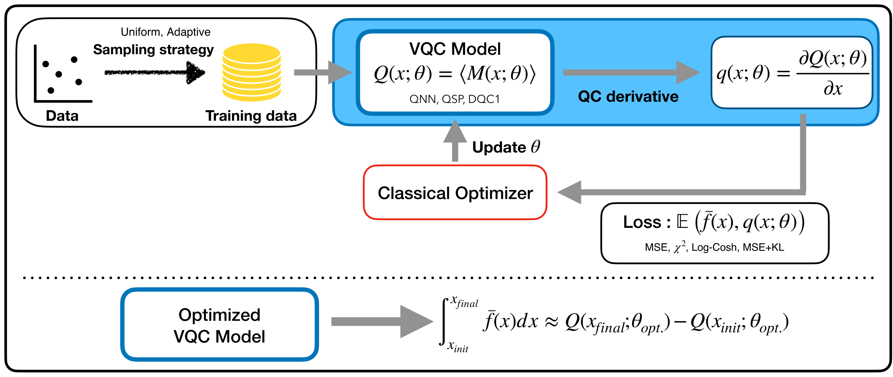

# QuInt-Net : Learning Functions with Sharp Features Using Quantum Neural Networks

## Overview

[](./Figure/Schematics.pdf)

Traditional Monte Carlo methods and numerical integration often struggle with slow convergence when evaluating integrals involving functions with singular features, such as rapidly varying regions or narrow peaks.
In this study, we present the impact of sampling strategies and loss functions on integration efficiency in the Quantum Integration Network (QuInt-Net).
We compare adaptive and non-adaptive sampling techniques and analyze how different loss functions influence integration accuracy and convergence rates.
Additionally, we explore quantum circuit architectures for numerical integration, comparing three different models: the data re-uploading model (QNN), the quantum signal processing protocol (QSP), and the deterministic quantum computation with one qubit (DQC1) model.
Our findings offer valuable insights into optimizing QuInt-Nets for applications in high-energy physics.

QuInt-Net learns an antiderivative with a parameterized quantum circuit. Training matches its input derivative to a normalized integrand. After training, two circuit evaluations give the integral over a chosen interval, with the input Jacobian and output scale restored.
The three one-dimensional benchmarks are a complex periodic function (CPF), a step function (Step), and a Breit–Wigner line shape (BW). The archived ideal-simulator comparisons use ten layers, with 62 parameters for QNN, 21 for QSP, and 86 for DQC1.

***

## Key Features

* **Quantum Circuit-Based Integration**: Designs quantum circuits using PennyLane to perform integral calculations with the QNN, QSP and DQC1 architectures.
* **PyTorch Integration**: Uses PyTorch to optimize the parameters of the quantum circuit and train the model on CPU or GPU.
* **Noise Studies**: Trains and evaluates QNN under gate-parameter errors and under terminal or layerwise bit-flip and depolarizing channels.
* **Seeded Benchmarks**: Repeats training over independent seeds with resumable checkpoints and per-seed error metrics.
* **Classical Baselines**: Compares direct Monte Carlo integration with a 62-parameter MLP trained on sampled function values.
* **Data Analysis and Visualization**: Analyzes experimental results using Jupyter Notebooks and visualizes them clearly with matplotlib.

***

## Code Structure
```text
QML_Integral
├── Analysis & Plot Making/        # Analysis notebook, benchmark helpers and classical baselines
│   ├── Analysis.ipynb             # Comparison of the published seed results
│   ├── analyze_gs.py             # GS coordinate counts and validation overlap
│   ├── analyze_hmc.py            # Independent HMC chain diagnostics
│   ├── benchmark_training.py      # Seeded training and checkpoint evaluation
│   ├── qnn_results.py             # Physical normalization and integral errors
│   └── Classic_Code/              # Plain MC and MLP baselines
├── Data File/                     # Fixed datasets, sampling notebook and archived benchmark CSVs
│   └── Benchmark Results/         # Published per-seed, interval and summary CSVs
├── Figure/                        # Manuscript figures
├── Additional_Running.py          # Continue training from saved single-model weights
├── Running_QuInt.py               # Main execution code
└── environment.yml                # Conda environment
```
***

## Tech Stack

* **Languages**: Python 3.11, Jupyter Notebook
* **Libraries**:
    * PennyLane: For building and simulating quantum circuits
    * PyTorch: For model training and optimization
    * NumPy and SciPy: For numerical operations and reference integrals
    * Matplotlib: For data visualization
    * tqdm: For training progress bars

***

## Getting Started

### 1. Clone the repository

```bash
git clone https://github.com/HeechanYi/QML_Integral.git
cd QML_Integral
```

### 2. Install the necessary libraries

From the repository root, create the Python 3.11 environment.

```bash
conda env create -f environment.yml
conda activate QuInt_Net
```

The environment file pins the local CPU setup. The archived GPU runs used PyTorch 2.3.0 with CUDA 12.1, PennyLane 0.41.1 and NumPy 1.26.4. For GPU execution, install a CUDA-enabled PyTorch build and pass `--device cuda:0` for training.

-----

## Usage

The main script (`Running_QuInt.py`) uses command-line arguments to configure experiments. Run it from the repository root.

### Basic Execution

To run the script with default settings, use the following command:

```bash
python Running_QuInt.py
```

  * **Default Configuration**: This trains a single `QNN` model in the `Ideal` environment with `10` layers on the `BW` test function, using `Uni` samples and the `MSE` loss.

### Custom Execution

You can specify your own settings by providing arguments after the script name.

**Command Format:**

```bash
python Running_QuInt.py [--arg1 value1] [--arg2 value2] ...
```

**Example 1: Train the QSP model on the 'CPF' function with 'GS' samples and the 'Log\_Cosh' loss function.**

```bash
python Running_QuInt.py --model_type QSP --layers 10 --test_func CPF --sample_type GS --loss_type Log_Cosh
```

**Example 2: Train the QNN model on 'BW' with layerwise bit-flip noise over ten seeds.**

```bash
python Running_QuInt.py --model_type QNN --env BitFlib_Layer --test_func BW --seeds 0 1 2 3 4 5 6 7 8 9
```

**Example 3: Train the QNN model on 'BW' with layerwise depolarizing noise on the CPU.**

```bash
python Running_QuInt.py --model_type QNN --env Depolarizing_Layer --test_func BW --seeds 0 --device cpu
```

### Available Arguments

  * `--model_type`: The model type to use.
      * **Choices**: `QNN`, `QSP`, `DQC1`
      * **Default**: `QNN`
  * `--env`: The noise environment.
      * **Choices**: `Ideal`, `GateError`, `BitFlip`, `Depolarizing`, `BitFlib_Layer`, `Depolarizing_Layer`
      * **Default**: `Ideal`
  * `--layers`: The number of layers in the circuit.
      * **Default**: `10`
  * `--test_func`: The test function data to use.
      * **Choices**: `CPF`, `Step`, `BW`
      * **Default**: `BW`
  * `--sample_type`: The data sampling method.
      * **Choices**: `Uni`, `GS`, `HMC`
      * **Default**: `Uni`
  * `--loss_type`: The loss function for training.
      * **Choices**: `MSE`, `Log_Cosh`, `Chisqr`, `MSE_KL`
      * **Default**: `MSE`
  * `--num_epochs`: The number of training epochs.
      * **Default**: `1000`
  * `--lr`: The learning rate for the optimizer.
      * **Default**: `0.001`
  * `--batch_size`: The batch size for training.
      * **Default**: `128`
  * `--device`: The PyTorch device for training.
      * **Default**: `cuda:0` if CUDA is available, otherwise `cpu` (overridable with the `QUINT_DEVICE` environment variable)
  * `--seeds`: One or more unique integer seeds. Supplying this option selects seeded benchmark training.
      * **Default**: None (single run)
  * `--results_dir`: The output directory for seeded benchmark runs.
      * **Default**: `Results/`

### Noise Environments

| QNN environment | Operation |
| --- | --- |
| `Ideal` | Unitary circuit |
| `GateError` | Gaussian parameter perturbation with standard deviation 0.001 |
| `BitFlip`, `Depolarizing` | Independent channels on both wires after the final rotations |
| `BitFlip_Layer`, `Depolarizing_Layer` | Independent channels on both wires immediately after the CZ in each re-uploading layer |

All four Pauli-channel environments use probability 0.001 per wire. Training and evaluation use the same channel placement. The two layerwise environments apply to QNN only.

### Seeded Benchmark Runs

Supplying `--seeds` selects benchmark training. All three ideal models support CPF, Step and BW. The seeded noise study uses QNN on BW. Each seed independently initializes the model and splits the fixed 5,000 points into 4,000 training and 1,000 validation points. Defaults are ten layers, Adam with learning rate 0.001, batch size 128 and up to 1,000 epochs. The minimum-validation-loss weights are evaluated.

Seeded runs save per-seed weights, split indices, histories, interval and bin predictions, error metrics and metadata under `Results/<model>/<env>/<benchmark>/<sampler>/<loss>/<lr>/seed_<n>/`. Repeat the same command to resume from the group checkpoint. Use `--results_dir` to keep different settings or seed groups separate.

### Additional Training

Single runs save weights, training histories and plots under `Model/`. To continue from those weights, run `Additional_Running.py` with the same model, environment, dataset, layer count and learning rate, and pass the saved weight filename with `--model`. Note that its defaults are `--model_type DQC1` and `--test_func CPF`, so set both explicitly.

```bash
python Additional_Running.py --model_type QNN --test_func BW --model <saved_weights>.pt
```

### Appendix Sampling Diagnostics

From the repository root, run the GS analysis on the fixed datasets and the HMC diagnostics on ten independent chains per benchmark.

```bash
python "Analysis & Plot Making/analyze_gs.py"
python "Analysis & Plot Making/analyze_hmc.py"
```

Both scripts print summary statistics and save plots in `Figure/`. The HMC summary includes acceptance rates, lag-one autocorrelation and median effective sample size for the chain position.

### Classical Baselines

The MLP reads fixed NPZ data (`x_data`, `y_data`, `x_init`, `x_final`) with `--data_file`, or selects a benchmark file with `--test_func` and `--sample_type`. Plain MC selects the integrand with `--function CPF|STEP|BW` and reuses each uniform sample across all integration intervals.

In the revision workspace, run these examples from `Rev_Round2/comment4/Classic_Code/`, which contains the matching `classic_utils.py`. The helper currently in this repository still uses the BW-specific data loader and reference-integral interface.

```bash
python running_MLP.py --data_file my_data.npz --loss_type MSE
python running_MC.py --function STEP --n_samples 5000 --n_trials 10
```

***

## Results

Open `Analysis & Plot Making/Analysis.ipynb` to compare the published seed results under `Data File/Benchmark Results/`. The `Figure` folder contains the manuscript figures saved as PDF files.

The nine fixed NPZ datasets in `Data File/` (CPF, Step and BW, each with `Uni`, `GS` and `HMC` samples) contain coordinates, function values and domain endpoints. The original HMC chain settings for the archived CPF and Step datasets remain unconfirmed.

### Data

The following CSV files are in [Data File/Benchmark Results](./Data%20File/Benchmark%20Results/). Each training configuration uses ten seeds (0–9) on a fixed dataset. BW integral estimates, integral errors and their standard deviations are in GeV⁻³; multiply BW integral estimates by 10⁵ to obtain the numbers in Table IV. CPF and Step values are dimensionless. Relative errors stored as fractions (`relative_error*`, `mean_absolute_relative_error`) must be multiplied by 100 for the percentages in the manuscript. Columns ending in `_pct` are already in percent.

| Analysis | Files | Contents |
| --- | --- | --- |
| Ideal QNN benchmarks (main-text tables, Appendix C) | `QNN_per_seed.csv`, `QNN_summary.csv`, `QNN_intervals.csv` | 360 runs: CPF, Step and BW × 12 sampling–loss combinations × 10 seeds. Per-seed 30-bin integral MAE and derivative R², per-configuration means, sample SDs and MAE rank, and the three selected intervals and the full domain with estimate, absolute error and relative error. |
| QSP and DQC1-style circuits (Appendix C) | `qsp_dqc1_seed_runs.csv`, `qsp_dqc1_summary.csv`, `qsp_dqc1_interval_summary.csv` | The same layout for QSP and the DQC1-style circuit with a pure work register (720 runs). |
| Table IV, layerwise noise | `QNN_layer_noise_intervals.csv`, `QNN_layer_noise_interval_summary.csv` | 240 BW training runs (two channels × 12 combinations × 10 seeds), four intervals per run. The archived channel labels `BitFlip` and `Depolarizing` refer to channels after each layer's CZ. For Table IV, select `M +/- 10 Gamma`. `between_training_seed_sd` is the SD across the ten seeds, and `mean_absolute_relative_error` gives the table percentage. |
| Table IV, Gaussian parameter perturbations | `QNN_gaussian_summary.csv` | Mean of 1,000 integral estimates over `M +/- 10 Gamma` for each archived checkpoint from the original submission. Each estimate perturbs the two endpoint evaluations independently. `perturbation_sd` uses the 1,000 estimates (ddof = 0), and `absolute_relative_error_of_mean_pct` is the table percentage. |
| GS diagnostics (Appendix A) | `GS_summary.csv` | Distinct coordinates, duplicate-draw percentage, maximum multiplicity and training–validation overlap (mean and SD over the ten saved splits) for each GS dataset. |
| HMC diagnostics (Appendix A) | `HMC_per_chain.csv`, `HMC_summary.csv` | Ten independently seeded diagnostic chains per benchmark. Per-chain acceptance rate, ESS of the mean position, lag-1 and lag-100 autocorrelations, and per-benchmark acceptance mean and SD with median, minimum and maximum ESS. |
| Classical BW comparison | `Classical_Result(BW).csv`, `Classical_result(BW-seed).csv`, `Evaluation_Budgets(BW).csv` | Aggregate file: 30-bin MAE and mean absolute relative errors (%) on `M ± 3Γ`, `M ± 5Γ`, `M ± 10Γ` and the full domain for QNN and MLP (Uniform–MSE and lowest-mean-MAE configurations) and plain MC with 5,000 and 100,000 samples. Per-seed file: interval estimates and errors for all 12 QNN and 12 MLP configurations × 10 seeds and for ten 5,000-sample MC trials. Budget file: sampler and labelling evaluations used to generate the uniform, GS and HMC datasets. |
| Classical CPF and Step comparison | `Classical_result(CPF, STEP).csv`, `Classical_result(CPF, STEP-seed).csv` | Aggregate file in the same layout as the BW comparison. `int1` and `int2` give mean absolute relative errors (%). `int3` and the full domain have zero reference integrals, so their mean absolute errors are reported. `n_samples` is the number of training points (networks) or MC samples and excludes the cost of generating GS and HMC datasets. Per-seed file: MLP MAE, derivative R², best epoch and completed epochs for 12 combinations × 10 seeds on CPF and Step (240 runs); the corresponding QNN runs are in `QNN_per_seed.csv`. |

The revised figures show the [fixed training datasets](./Figure/Sampling_fixed.pdf), [GS validation overlap](./Figure/GS_validation_overlap.pdf), [HMC diagnostics](./Figure/HMC_diagnostics.pdf) and [BW comparison](./Figure/BW_budget_comparison.pdf).

* Integral MAE is the mean absolute integral error over 30 equal subintervals. BW integral errors are in GeV⁻³. CPF and Step integral errors are dimensionless.
* Seed variation measures training variability on a fixed dataset.
* GS weights depend on secant slopes between successive candidates in their stored order.
* The QNN code measures the mean of the two single-qubit Pauli Z observables. A terminal independent bit-flip channel on each measured wire scales this readout by `1 − 2p`, and the depolarizing channel scales it by `1 − 4p/3`. Both use `p = 0.001`.

***


## Citation

If our code benefits your research, please acknowledge our efforts by citing the following paper:

```bibtex
@article{Yi:2025QuIntNet,
  title         = {Quantum Integration Networks for Efficient Monte Carlo in High-Energy Physics},
  author        = {Yi, Heechan and Ban, Kayoung and Park, Myeonghun and Kong, Kyoungchul},
  journal       = {arXiv preprint arXiv:2510.10501},
  year          = {2025},
  eprint        = {2510.10501},
  archivePrefix = {arXiv},
  primaryClass  = {quant-ph}
}
```

## Reference

* H. Yi, K. Ban, M. Park and K. Kong, *Quantum Integration Networks for Efficient Monte Carlo in High-Energy Physics*, [arXiv:2510.10501](https://arxiv.org/abs/2510.10501).


## License

This project is licensed under the MIT License. See the `LICENSE` file for details.
